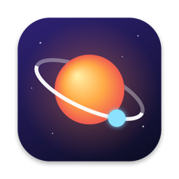
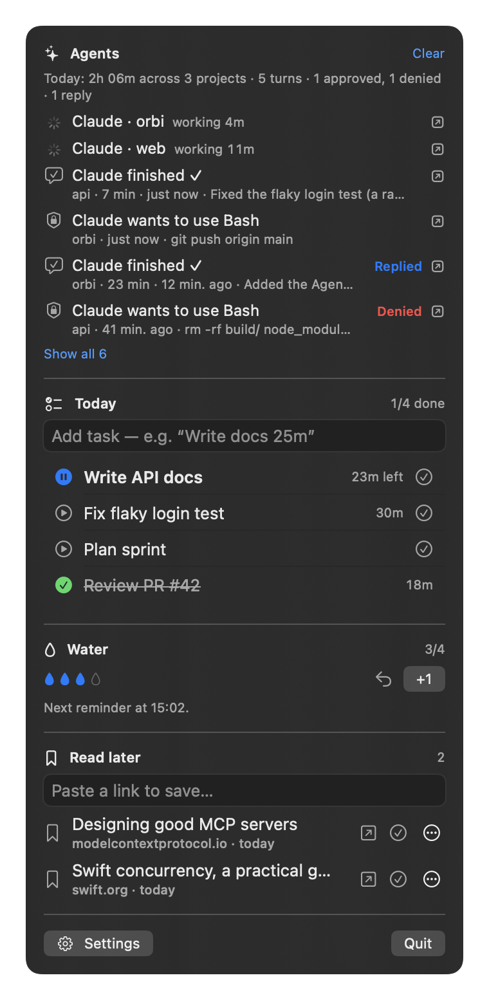
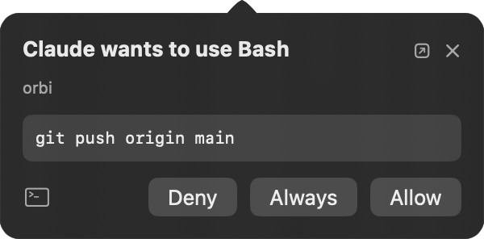
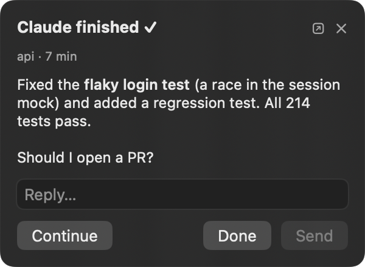

<p align="center">
  
</p>

<h1 align="center">Orbi</h1>

<p align="center">
  <b>The menu bar companion for people who work with AI agents.</b>
</p>

<p align="center">
  Hand Claude Code a task and switch away: when it needs permission or finishes, a bubble drops from the menu bar
  so you can approve or send the next instruction without going back to the terminal.
  A 🤖 shows who's working, and the panel keeps a log of everything your agent did today.
</p>

<p align="center">
  
  
  
  
</p>

<table>
  <tr>
    <td rowspan="2" valign="top"></td>
    <td valign="top"></td>
  </tr>
  <tr>
    <td valign="top"></td>
  </tr>
</table>

## Why

Working with agents means a lot of waiting and a lot of window switching. You start a run, switch to something else, and either keep checking the terminal or forget about it for 20 minutes. Orbi sits in the menu bar and fixes both:

1. **It tells you when the agent is done**, so you can stop watching the terminal.
2. **It fills the wait with what matters**: your next task, a glass of water, that article you saved.
3. **Your agent can see your day too.** Ask it to plan your tasks, log water or tell you what you read this week. Orbi speaks MCP.

## Features

### For your AI agents
- **Approve from the menu bar.** When Claude Code asks "may I run this?", a bubble shows the exact command with **Allow / Deny**, plus **Always** when Claude offers a "don't ask again" rule. No more switching windows to press Enter.
- **Reply from the menu bar, in any terminal.** When a long turn ends, the bubble shows what Claude said. Type your next instruction right there (or hit **Continue**) and Claude picks it up. It works with Terminal, iTerm2, VS Code, Cursor and more, no tmux needed, because it uses Claude Code's own hooks.
- **The orbit is the status.** Orbi's menu bar icon is a little orbit: **dashed** while an agent works, **blue** when it's your turn (Claude finished or asks you something), faint otherwise. Blue stays until you answer, start the next prompt or open Orbi, so you never miss a finished turn. Colour-blind safe: shape plus one colour.
- **Jump back in one click.** Every bubble and Agents row has a ↗ button that brings the agent's terminal or IDE to the front (Terminal, iTerm2, VS Code, Cursor, Ghostty, …).
- **Daily summary.** "Today: 2h 10m across 3 projects · 14 turns · 12 approved · 3 replies", at the top of the Agents list and in `get_status`.
- **See what your agent did.** The **Agents** list at the top of Orbi's panel keeps every finished turn (with Claude's last message), every permission request (with your answer) and your replies. Click a row to read it in full, or ask your agent "what did you do today?" over MCP.
- **"Agent finished" bubble.** A small bubble under the menu bar icon when Claude Code, Gemini CLI or Codex finishes a turn longer than a minute: *"Claude finished ✓ · my-project · 7 min"*. Short replies stay quiet.
- **MCP server.** Claude (Desktop and Code), Gemini CLI, Cursor, VS Code and any other MCP client can read your day and act on it: "plan my day: API docs 45m, review PR 20m", "start the next task", "save this link for later".
- **Ping on request.** In chats without hooks (Claude Desktop), say "notify me on Orbi when you're done" and the agent calls the `notify` tool.
- **Zero-setup server.** One Python file, standard library only, runs on the macOS system Python. It starts only when the agent needs it.

### For you, while the agent works
- **Tasks with a timer.** One active task with a countdown in the menu bar. The clock pauses while the Mac sleeps or the screen is locked. Type `Write report 25m` to set an estimate. Tasks can be planned for later days.
- **Water and breaks.** Quiet reminders toward a daily goal. They skip calendar meetings.
- **Read later.** Save a link, close the tab, and get one gentle nudge a day to actually read it. Finished items are kept, so you can look back at what you read.
- **Scriptable.** Everything is reachable through `orbi://` URLs (Shortcuts, shell scripts, CI). The current state is written to a `status.json` file.

Only want the agent part? **Settings → Panel** hides Water and Read later (and their reminders).

**Private by design:** a sandboxed SwiftUI + SwiftData app with no network access, no accounts and no analytics. It uses almost nothing while idle.

## Install

Requirements: macOS 14+, Xcode 26+, [XcodeGen](https://github.com/yonaskolb/XcodeGen) (`brew install xcodegen`).

```sh
git clone https://github.com/clerancebae/orbi.git
cd orbi
# Use your own signing team and bundle prefix:
#   edit DEVELOPMENT_TEAM and bundleIdPrefix / com.berke.* in project.yml
scripts/install.sh   # Release build → /Applications/Orbi.app → launch
```

## Connect your AI agent

Open Orbi's **Settings → AI agents** and click **Connect** next to Claude Code (or Gemini CLI). Orbi adds its hooks to the agent's `settings.json`; your own hooks and settings stay as they are, and a backup is kept as `settings.json.orbi-backup`. **Disconnect** removes only Orbi's entries. The scripts ship inside Orbi.app, so there's nothing else to download.

To let your agent see your day (MCP), use the **Copy Claude Code command** button in the same section, or **Copy JSON** for Claude Desktop, Cursor, VS Code and other MCP clients. Tools: `get_status`, `add_tasks`, `start_next_task`, `complete_active_task`, `log_water`, `undo_water`, `save_for_later`, `open_next_reading`, `notify`.

Manual setup and details for every hook event are in [mcp/README.md](mcp/README.md).

## URL scheme

```sh
open -g "orbi://task/add?title=Review+PR&min=30&date=tomorrow"
open -g "orbi://task/start-next"
open -g "orbi://water/add"
open -g "orbi://reading/save?url=https%3A%2F%2Fexample.com"
open -g "orbi://notify?title=Build+done&message=All+green"
```

The full list is in [docs/DECISIONS.md](docs/DECISIONS.md).

## Development

See [docs/DEVELOPMENT.md](docs/DEVELOPMENT.md) for build, test and debugging notes, and [docs/DECISIONS.md](docs/DECISIONS.md) for why things are the way they are. The app icon is drawn in code: `swift scripts/make_icon.swift icon.png`.

## License

[MIT](LICENSE)
